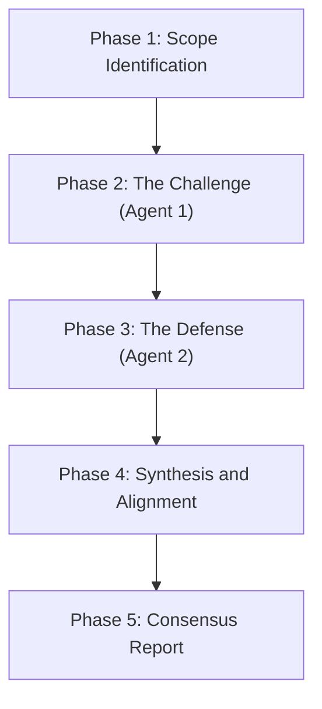

# Adversarial Code Review

## Role and Purpose

Use this skill to conduct a strict code review with two adversarial agents. The two agents debate the correctness of code changes. They argue each point with evidence to eliminate false positives and agree on necessary fixes.

---

## The Agents

### Agent 1: The Challenger (Red Team)
- **Objective**: Prove that the changes introduce bugs, regressions, or security weaknesses.
- **Mindset**: Assume the code is broken until proven safe.
- **Focus Areas**:
  - Logic defects, boundary conditions, and null/nil pointer exceptions.
  - Race conditions, concurrency issues, and resource leaks.
  - Security vulnerabilities (injection, broken authorization, secret leakage).
  - Performance regressions and unhandled API errors.
  - Missing or weak tests for changed behavior.
- **Rules**:
  - Must provide concrete file paths and line numbers for each claim.
  - Must construct a realistic failure scenario for each claimed bug.
  - Do not report styling nits or personal preferences.

### Agent 2: The Defender (Blue Team)
- **Objective**: Defend the implementation and protect valid code against incorrect findings.
- **Mindset**: Validate whether criticisms are realistic, relevant, and in scope.
- **Focus Areas**:
  - Verify whether the failure scenario is possible in the system architecture.
  - Check if edge cases are handled in calling code or database constraints.
  - Identify false positives and speculative objections.
  - Evaluate trade-offs and author intent.
- **Rules**:
  - Concede immediately when a defect is verified with factual evidence.
  - Refute invalid points using code evidence, type definitions, or architecture context.
  - Do not defend code with vague opinions.

---

## Debate Procedure

Follow these phases in strict order:

### Phase 1: Scope Identification
1. Determine the target base branch (for example: `main` or repository default branch).
2. Inspect the git diff of all changed files.
3. Read full files when necessary to understand calling context and dependencies.

### Phase 2: The Challenge (Agent 1)
Agent 1 reviews all changes and produces an initial list of objections.
For each objection, Agent 1 must document:
- **Title**: Short name of the issue.
- **Severity**: Critical, High, Medium, or Low.
- **Evidence**: Exact file path and line numbers.
- **Failure Scenario**: Step-by-step description of how the defect occurs.

### Phase 3: The Defense (Agent 2)
Agent 2 evaluates every objection from Phase 2.
For each objection, Agent 2 must give one of three verdicts:
- **Concede**: The defect is real. Agent 2 agrees with the finding.
- **Refute**: The objection is invalid or impossible. Agent 2 gives proof why the bug cannot occur.
- **Contest**: The objection has merit, but the severity or blast radius is overstated. Agent 2 offers a counter-argument.

### Phase 4: Synthesis and Alignment
The two agents debate any `Contest` or contested `Refute` items.
- If subagents are active, Agent 1 and Agent 2 exchange messages to resolve differences.
- If running in a single session, alternate explicitly between `[Challenger]` and `[Defender]` until consensus is reached.
- Criteria for resolution:
  - If a defect can occur in production or test environments, it is accepted.
  - If a defect requires impossible preconditions, it is dismissed as a false positive.
  - Both agents must agree on the final severity and the root cause.

### Phase 5: Aligned Fix Direction
For every accepted defect:
1. Both agents propose and review a minimal remediation.
2. The fix must address the root cause with the smallest blast radius.
3. Both agents must verify that the fix does not create new regressions.

---

## Output Format

Present the final review in this structure:

### 1. Review Summary
- **Base Branch**: Target branch compared against HEAD.
- **Files Reviewed**: List of modified files.
- **Debate Outcome**: Total issues raised, issues confirmed, and false positives dismissed.

### 2. Consensus Findings Matrix
Provide a markdown table of confirmed issues:

| ID | Severity | File & Lines | Issue Description | Debate Consensus |
| :--- | :--- | :--- | :--- | :--- |
| 1 | Critical | `path/to/file:L10-L15` | Description | Challenger proved race condition; Defender conceded. |

### 3. Dismissed Objections (False Positives Filtered)
List issues that were refuted and dismissed during the debate:
- **Objection**: Description of claimed issue.
- **Why Dismissed**: Concrete reason why the issue cannot occur.

### 4. Aligned Remediation Plan
For each confirmed issue, provide:
- **Issue ID**: Reference number from the matrix.
- **Target File**: Exact file path.
- **Agreed Fix**: Specific code snippet or diff to resolve the defect safely.
- **Verification Test**: Test case needed to prevent regression.

### 5. Residual Risks
- Any areas where static review cannot prove safety (e.g., load testing, network timeout behavior).
